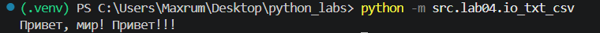
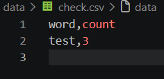
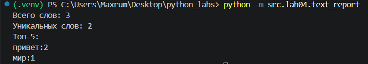
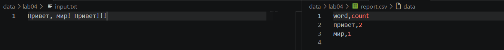

## ЛР4 — Файлы: TXT/CSV и отчёты по текстовой статистике

# Задание 1 (io_txt_csv.py)
Реализованы функции:

 `read_text(path: str | Path, encoding: str = "utf-8") -> str`
 - открывает файл в указанной кодировке и возвращает содержимое как строку
 - файл не найден - FileNotFoundError
 - неправильная кодировка - UnicodeDecodeError

 `ensure_parent_dir(path: str | Path) -> None`
 - Создает родительские директории, если их нет

`write_csv(rows: list[tuple | list], path: str | Path, header: tuple[str, ...] | None = None) -> None`
- создает/перезаписывает CSV
- записывет header в качестве заголовка
- разная длина строк - ValueError

# Задание 2 (text_report.py)
Скрипт:
1. Читает один входной файл data/input.txt (путь задан константой в коде)
2. Нормализует текст, токенизирует и считает частоты слов.
3. Сохраняет data/report.csv c колонками: word,count, отсортированными: count ↓, слово ↑ (при равенстве).
4. В консоль печатает краткое резюме

