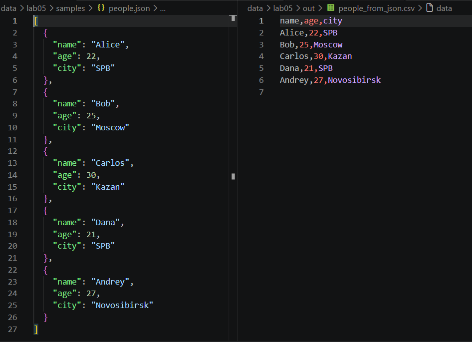
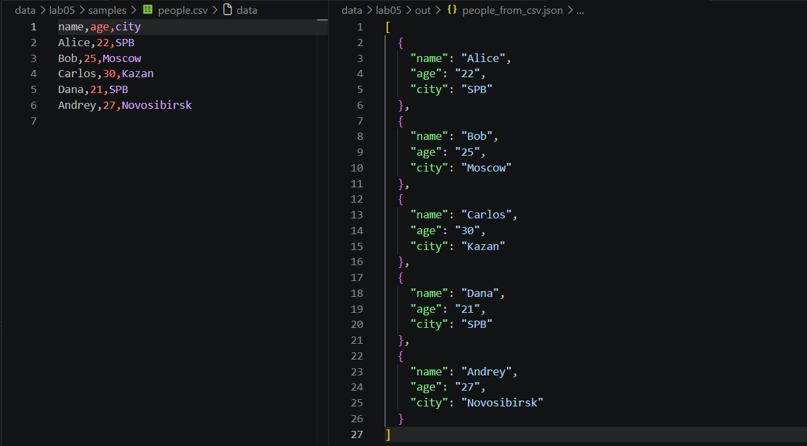
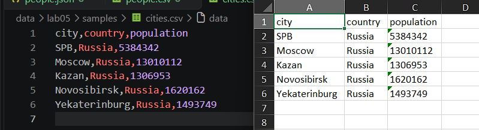

## ЛР5 —  JSON и конвертации (JSON↔CSV, CSV→XLSX)

# Задание A (JSON ↔ CSV)

`def json_to_csv(json_path: str, csv_path: str) -> None`
- Преобразует JSON-файл в CSV.
- Поддерживает список словарей, заполняет отсутствующие поля пустыми строками.
- Кодировка UTF-8.

Пример работы функции:

`def csv_to_json(csv_path: str, json_path: str) -> None`
- Преобразует CSV в JSON.
- Заголовок обязателен, значения сохраняются как строки.

Пример работы функции:

# Задание B (CSV → XLSX)
`def csv_to_xlsx(csv_path: str, xlsx_path: str) -> None`
- Конвертирует CSV в XLSX.
- Первая строка CSV — заголовок.
- Лист называется "Sheet1".
- Колонки — автоширина по длине текста (не менее 8 символов).

Пример работы функции:

