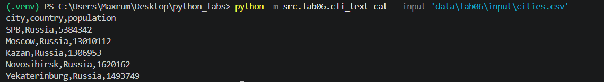
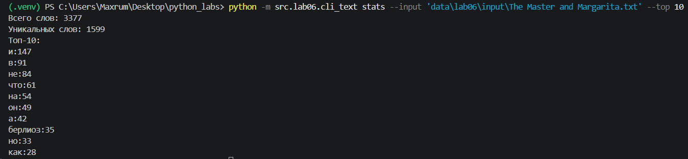
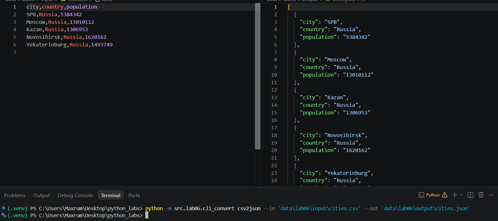
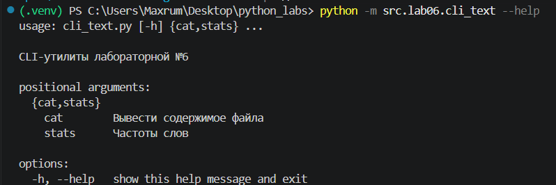

## ЛР6 — CLI-утилиты и работа с данными

# Задание 1 (cli_text.py)

Реализованы две консольные команды для обработки текстовых файлов:

- `cat --input <path> [-n]`
  - выводит содержимое файла в консоль;
  - опция `-n` добавляет нумерацию строк.

- `stats --input <path> [--top N]`
  - выводит общее количество слов, число уникальных слов и топ-N самых частых слов(по умолчанию - 5).

Примеры использования:

# Задание 2 (cli_convert.py)

CLI-конвертер для форматов данных:

- `json2csv --in <input.json> --out <output.csv>`
  - преобразует JSON в CSV;

- `csv2json --in <input.csv> --out <output.json>`
  - преобразует CSV в JSON;

- `csv2xlsx --in <input.csv> --out <output.xlsx>`
  - преобразует CSV в XLSX.

Пример использования:

# Help
Для каждой команды доступно описание (--help).
