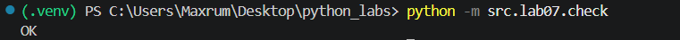
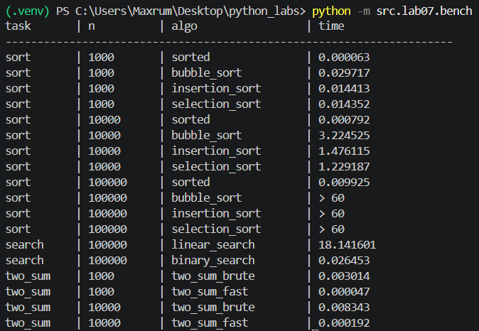

# ЛР7 — Поиск, сортировка и измерение времени

## check.py

## Отчёт

Время указано в секундах. Результаты приведены из `data/lab07/bench.csv`; значения `> 60` означают, что сортировка не завершилась за 60 секунд.

Пузырьковая сортировка имеет квадратичную сложность `O(n²)`: при увеличении размера данных в 10 раз число сравнений и потенциальных перестановок растёт примерно в 100 раз. Это видно и в измерениях: от 1 000 до 10 000 элементов время выросло примерно в 109 раз (0.029717 → 3.224525 с), что близко к ожидаемому. Встроенная `sorted` использует алгоритм `O(n log n)`: при десятикратном росте `n` время увеличивается примерно в `10 * log(10n) / log(n)` раз. Для 10 000 → 100 000 элементов это около 12,5 раза теоретически и по факту (0.000792 → 0.009925 с).

Бинарный поиск нельзя применять к неотсортированным данным: он отбрасывает половину диапазона, опираясь на порядок элементов, и без него может пропустить искомое значение или вернуть неверный результат. Чтобы выполнить поиск, данные сначала нужно отсортировать; для одного или небольшого числа запросов эта подготовка может стоить дороже линейного поиска. Сортировка окупается, когда один и тот же упорядоченный набор используется для большого числа запросов: затраты на сортировку выполняются один раз, а каждый последующий бинарный поиск занимает `O(log n)`. Для 100 000 элементов и 10 000 запросов время бинарного поиска уже включает сортировку (0.026453 с) и существенно меньше времени серии линейных поисков (18.141601 с).