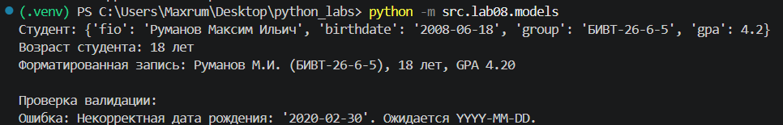
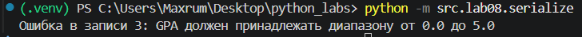

# ЛР8 — Модели данных и сериализация


## models.py

Файл `models.py` содержит функции для работы со студентами.

Поля записи:

- `fio` — ФИО студента;
- `birthdate` — дата рождения в формате `YYYY-MM-DD`;
- `group` — учебная группа;
- `gpa` — средний балл от `0.0` до `5.0`.

Основные функции:

- `make_student(...)` — создаёт и валидирует запись студента;
- `validate_student(...)` — проверяет набор ключей и значения записи;
- `student_age(...)` — вычисляет возраст на указанную дату;
- `student_to_dict(...)` — возвращает копию валидной записи;
- `student_from_dict(...)` — создаёт запись из словаря;
- `format_student(...)` — форматирует данные для вывода.

Пример запуска модуля:
```python
student = make_student("Руманов Максим Ильич", "2008-06-18", "БИВТ-26-6-5", 4.2)
print(f"Студент: {student}")
print(f"Возраст студента: {student_age(student)} лет")
print(f"Форматированная запись: {format_student(student)}")

print("Проверка валидации:")
try:
    invalid_student = make_student("Клод Клодович", "2020-02-30", "БИВТ-26-6-2", 6.7)
except ValueError as e: 
    print(f"Ошибка: {e}")
```



## serialize.py

Файл `serialize.py` содержит функции:

- `students_to_json(students, path)` — валидирует записи и сохраняет их в JSON;
- `students_from_json(path)` — читает JSON-массив.

Strict политика ошибок:
при битой записи выводится номер записи и текст ошибки. 

Пример запуска:

```powershell
python src\lab08\serialize.py
```

Исходные данные находятся в `data/lab08/`:

- `students_input.json` — корректный набор студентов;
- `students_bad.json` — набор с некорректным средним баллом;
- `students_output.json` — результат сохранения данных.

## Пример кода

```python
input_path = "data/lab08/students_input.json"
bad_path = "data/lab08/students_bad.json"
output_path = "data/lab08/students_output.json"

students = students_from_json(input_path)

students_to_json(students, output_path)

try:
    students_from_json(bad_path)
except ValueError as e:
    print(f"Ошибка: {e}")
```

Некорректная запись вызывает `ValueError` с описанием поля, которое не прошло проверку:

