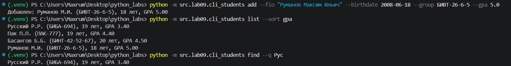
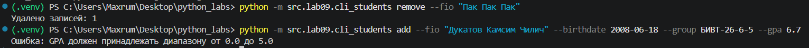

# ЛР9 — CSV-база студентов

## `group.py`

- `ensure_storage(path)` — создает каталог и CSV-файл с заголовком, если файла нет.
- `load_students(path)` — читает записи, преобразует GPA в число и проверяет заголовок и данные.
- `save_students(path, students)` — проверяет записи и сохраняет их в CSV.
- `add_student(path, student)` — добавляет валидную запись; запрещает дубликаты ФИО.
- `list_students(path, sort_by=None)` — возвращает список, при необходимости сортирует по ФИО или GPA.
- `find_students(path, substr)` — ищет студентов по подстроке в ФИО без учета регистра.
- `remove_student(path, fio)` — удаляет все записи с указанным ФИО и возвращает число удаленных записей.
- `update_student(path, fio, **fields)` — обновляет поля первой найденной записи; возвращает `True`, если студент найден.

## `cli_students.py`

Консольная утилита поддерживает подкоманды `add`, `list`, `find`, `remove` и
`update`. Список выводится с помощью `format_student` из ЛР8. CSV-файл хранится
по пути `data/lab09/students.csv`.

## Скриншоты работы

Добавление, сортировка списка и поиск:

Удаление и сообщение об ошибке при некорректном GPA:

